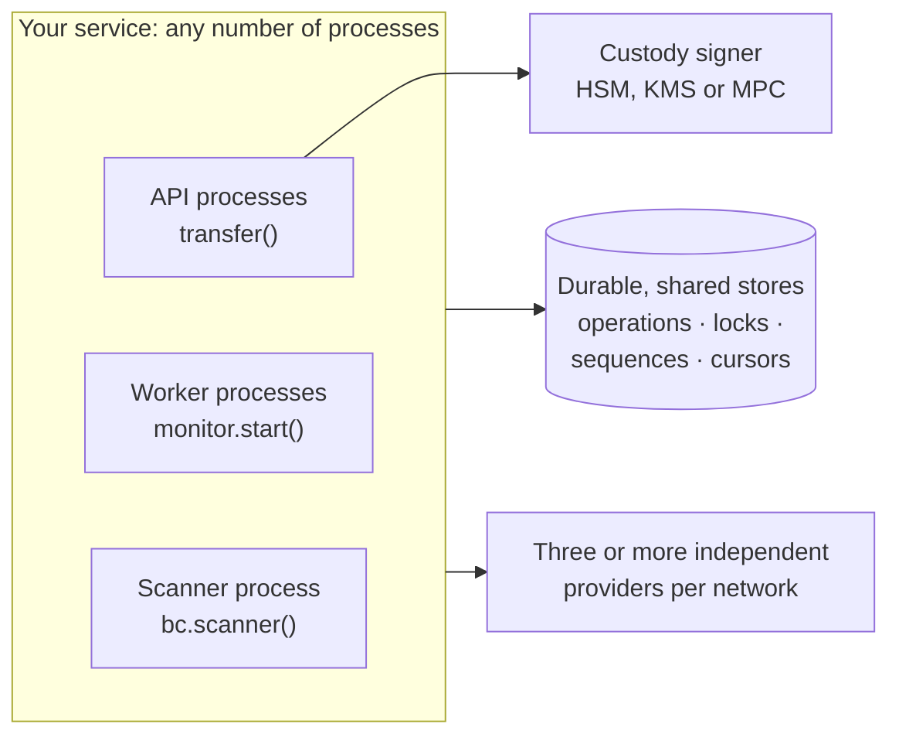

# Go to production

Everything in the other guides works on a laptop. Production adds what a laptop never
tests: several processes, restarts, a lying or lagging endpoint, a key that must never leak,
and money that must never move twice. [Production architecture](../tour/production.md)
shows how the pieces fit together; this page is the checklist to walk through before real
money moves.

## Production checklist

[Production architecture](../tour/production.md) has the fuller picture: what to monitor,
and drills for each failure.

### Tenants and stores

- [ ] One `new CryptoAio({ namespace })` per tenant. Scopes are not tenant boundaries.
- [ ] `lifecycle.requireIdempotencyKey: true`, with keys taken from durable business records.
- [ ] All four stores durable and shared (operations, locks, sequences, cursors), passing the
      contract suites ([Write a durable store](../explore/stores.md)). A store you leave out
      of `stores` falls back to a memory store without a warning, which breaks leases and
      the duplicate-transaction guard across processes.
- [ ] Stores served by the primary database, never a read replica: `findByRef` and the
      compare-and-set writes must see every write already committed.
- [ ] One clock for the stores and the container: a store stamps `createdAt`, `updatedAt` and
      lease expiry with the clock you give it, and the engine compares them with its own.
      Every host's clock in sync (NTP).
- [ ] The `namespace` never changes, and a restore never brings back an older store: either
      loses the idempotency records, so a repeated key pays again, and a sequence store that
      goes back hands out nonces already used. Back up the four stores together.
- [ ] `sensitive` fields encrypted at rest, with a retention policy. `purge` only terminal
      Operations, and only once no caller can retry their keys: a key used again after its
      Operation was purged pays again.

### Providers and proofs

- [ ] Three or more independent providers per network. A proof needs `proofQuorum` (2)
      endpoints, and an endpoint that is down still counts: with two, an outage of one stops
      every `final` verdict until it returns. Keep `transport.degradedProofs` off, which
      would let the last endpoint prove alone.
- [ ] No `public` preset in production: `bc.config` reports such a provider with
      `production: false`, and a handle with no provider falls back to it with a logged
      warning.
- [ ] `await bc.ready()` at startup, to fail fast on a missing SDK or a misconfigured
      provider.

### Keys and signing

- [ ] Custody signers (`callbackSigner`) for significant balances. No `exportable` keys. No
      keys in config files or source control. Every credential in a `Secret`.
- [ ] An idempotent, short `beforeSign` hook in front of your own policy engine. It reads the
      transfer's summary, which the driver builds from the same intent as the payload; a
      plugin family's driver must keep the two equal ([What the core trusts the driver
      for](../explore/plugins.md#what-the-core-trusts-the-driver-for)).
- [ ] Rotating a signer while Operations are in flight: keep the old wallet resolvable
      until they finish. `recover()` resends only through a wallet that resolves, and one
      whose signer is gone is counted `unresent`.
- [ ] Before mainnet, a rehearsal on a testnet or a local node with your stores, signers and
      providers. The EVM write path runs against a real node in this repository's CI; the
      other families' write paths run against scripted nodes only.

### Workers, startup and shutdown

- [ ] `aio.operations.recover()` at startup, then `aio.monitor.start()` workers.
- [ ] Timing that fits your stores and signers: `leaseMs` (30 s) well above a store write,
      since a lease is not renewed while `appendAttempt` runs; `claimLeaseMs` (60 s) above
      a worker pass; `leaseWaitMs` (`leaseMs`) above your signer's usual time, so transfers
      from one wallet queue behind a slow signer instead of failing with `SEQUENCE_BUSY`;
      `signTimeoutMs` (120 s) for the signer itself ([Run workers and recover](./workers.md)).
- [ ] Shutdown in order: abort the workers' signal, await them, then `await aio.close()`.

### Monitoring

- [ ] Alerts on `operation.stalled`, `nonce.gap`, `recovery.skipped`,
      `provider.misconfigured`, `provider.inconsistent` (endpoints disagree),
      `provider.health` with an `open` or `disabled` endpoint, `tx.reorged`,
      `scanner.rollback`, and `signer.completed` with an `error`.
- [ ] A backlog metric for Operations left in `created`, `prepared`, `awaiting-signature`
      or `stalled`, which only a caller moves on, and for ambiguous ones.
- [ ] The warning `skipped an operation stored in a newer record format`: a process older
      than the one that stored an Operation is still running.

### Upgrades

- [ ] crypto-aio pinned to an exact version; the [changelog](https://github.com/vhidvz/crypto-aio/blob/main/CHANGELOG.md)
      and [Upgrade to 1.0](../reference/upgrading.md) read before each upgrade, and
      `CRYPTO_AIO_*` deprecation warnings acted on.
- [ ] Every process upgraded before you rely on what the new version stores. Processes of
      two 1.x versions can share the stores meanwhile ([upgrades](../explore/stores.md#upgrades-and-the-record-format)).

### Deposits and withdrawals

- [ ] Complete withdrawals only on `final` with `proven` evidence. Credit deposits, which
      are `observed` in every family, only once read `final`, and automatically (or above
      your risk threshold) only once an independent provider reads the same transfer final
      ([Crediting deposits](./receive.md#crediting-deposits)). Dedupe deposits on the
      transfer id. On Bitcoin and Avalanche, skip a transfer whose `to` is among its `from`
      addresses (change, a cancel's refund), and never use a scanned deposit address as a
      change address.

### Per family

- [ ] EVM: `maxFeePerGas` and `maxGasLimit` set to your fee policy (1,000 gwei per gas and
      2^24 gas by default).
- [ ] Bitcoin: your own Esplora, with three or more independent endpoints as the `provider`
      and an `indexer` whose per-address limits fit your wallets; `lifecycle.broadcastFanout`
      of 2 or more; `nonWitnessUtxo` left on for hardware signers; and
      `allowExternalChangeAddress` only for a verified address.
- [ ] Tron: memos are public forever and cost a fee; never put personal data in one. Use the
      `trongrid` preset with a key on mainnet (keyless TronGrid fails there), next to
      independent providers. `maxFeeLimit` (100 TRX by default) set to the most a token
      transfer may burn.
- [ ] Solana: three or more independent keyed or self-hosted providers;
      `maxComputeUnitPrice` set to your fee policy; a store that keeps each Attempt's
      `ordering` whole; after a refusal, retry only with `rebroadcast` or the same
      idempotency key; credit SPL deposits by the owner wallet (`transfer.to`).
- [ ] TON: three or more independent toncenter-compatible pairs (`provider` and `indexer`),
      archival where they serve proofs, with a key on toncenter, never the `public` preset;
      wallets whose keys nothing else holds; a store that keeps each Attempt's `ordering`
      (`TonSeqnoOrdering`, `validFrom` included) exactly; a server clock in sync (builds
      refused for chain-time skew mean fix the clock); and jetton deposits credited only
      from the arrival in the owner's jetton wallet's history, never from the owner's
      notification, deduped on that transfer id, not on the trace id; the independent read
      that confirms a TON deposit uses another provider **and** indexer pair.
- [ ] Avalanche X-Chain and P-Chain: nodes plus a keyed Data API (`glacier`) as the
      `indexer`, never `public`; `maxFee` and, on the P-Chain, `maxGasPrice` set to your fee
      policy. There is no replace or cancel: a P-Chain transfer refused for its fee stays
      `stalled` with its inputs held until it is sent again, so never pay it again under a
      new idempotency key.
